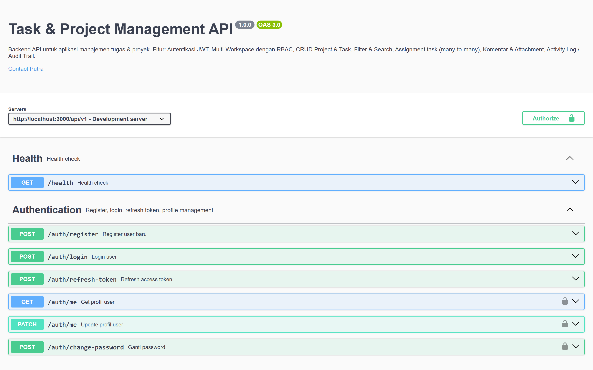
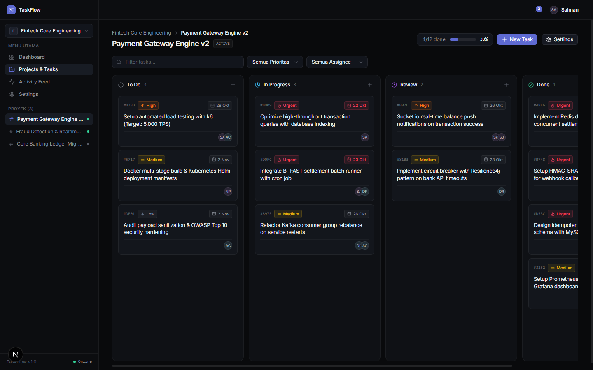
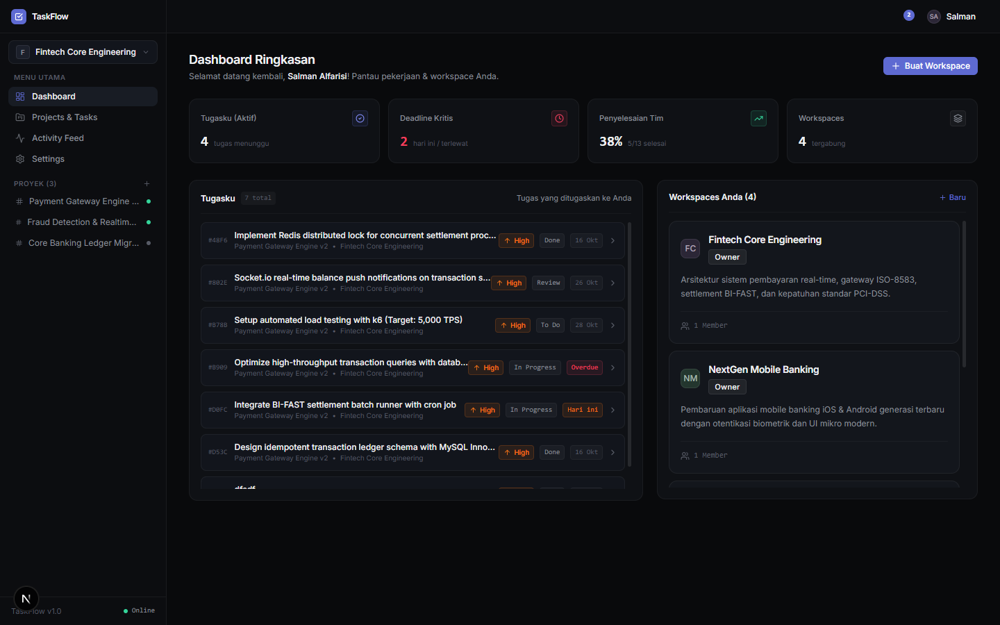
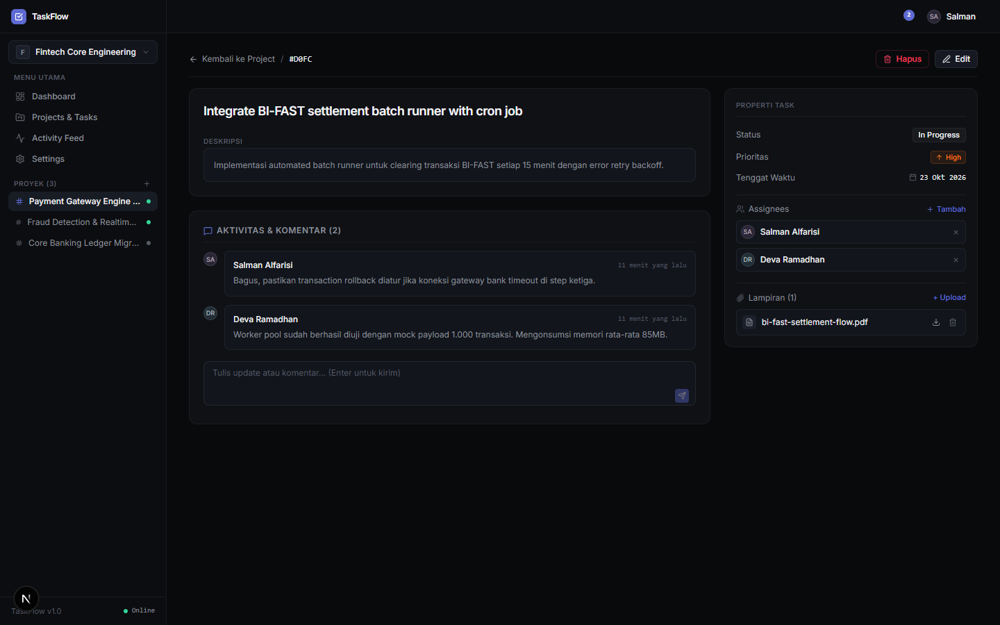
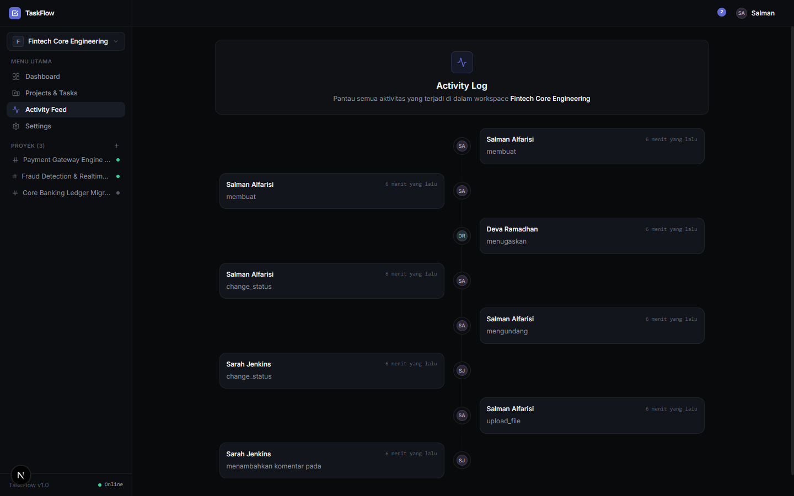

<div align="center">

# ⚡ Task & Project Management REST API

**Enterprise-grade REST API backend for collaborative workspace, multi-tenant projects, real-time Kanban boards, and RBAC team management.**

[](https://nodejs.org/)
[](https://expressjs.com/)
[](https://www.mysql.com/)
[](https://sequelize.org/)
[](https://socket.io/)
[](https://swagger.io/)

</div>

---

## 📸 Dokumentasi & Antarmuka Terintegrasi

### 📖 1. Dokumentasi Interaktif API (Swagger UI / OpenAPI)
Eksplorasi endpoint REST API interaktif, pengujian skema data, dan otentikasi Bearer JWT langsung melalui browser:

<p align="center">
  
</p>

---

<details open>
<summary><strong>🔍 Tampilan Integrasi Frontend (Next.js 16 + Linear Theme) ▾</strong></summary>
<br/>

| Modul | Preview Antarmuka |
|---|---|
| **Real-time Kanban Board**<br/>Pembaruan status task instan antar klien dengan Socket.io WebSocket rooms. |  |
| **Personal Dashboard & Deadline Alerts**<br/>Agregasi metrik task across-workspaces dan deteksi deadline kritis. |  |
| **Task Detail, Comments & Attachments**<br/>Stream diskusi live, manajemen multi-assignee, dan upload file attachment. |  |
| **Audit Log & Activity Feed**<br/>Pencatatan riwayat komprehensif untuk setiap mutasi status, role, atau komentar. |  |

</details>

---

## 🚀 Fitur Backend

- **Autentikasi & Autorisasi:**
  - Registrasi, Login, dan Logout.
  - JWT Dual-token mechanism (Access Token & Refresh Token) dengan enkripsi `bcryptjs`.
  - Granular RBAC (Role-Based Access Control): `Owner`, `Admin`, `Member`, dan `Viewer`.
- **Manajemen Workspace & Multi-Tenancy:**
  - Pembuatan workspace dan isolasi data proyek per organisasi.
  - Sistem undangan kolaborator via email dan penyesuaian role dinamis.
- **Manajemen Proyek & Kanban:**
  - Status proyek (`active`, `archived`, `completed`).
  - Pembuatan task dengan 4 status (`todo`, `in_progress`, `review`, `done`) dan 3 prioritas (`low`, `medium`, `high`).
  - Penugasan staf ke banyak user sekaligus (*multi-assignees*).
  - Pelacakan batas waktu (*due date*).
- **Kolaborasi Real-Time:**
  - Integrasi Socket.io untuk streaming komentar dan event mutasi status task real-time.
- **Audit Logging & Activity Trail:**
  - Histori otomatis setiap kali terjadi perubahan role, pembuatan task, pergantian status, atau penambahan komentar.
- **Dokumentasi Terbuka:**
  - Swagger UI / OpenAPI 3.0 terintegrasi pada endpoint `/api-docs`.
- **Database Seeder Otomatis:**
  - Script seeder portofolio siap pakai yang menginjeksikan data arsitektur sistem pembayaran (*Fintech Core Engineering*).

---

## 💻 Tech Stack

| Komponen | Spesifikasi |
| --- | --- |
| **Runtime & Framework** | Node.js & Express.js 5 |
| **Database** | MySQL 8 |
| **ORM** | Sequelize v6 |
| **Otentikasi** | JSON Web Token (jsonwebtoken) & bcryptjs |
| **Validasi Request** | express-validator |
| **Real-Time** | Socket.io |
| **File Storage** | Multer & Cloudinary (opsional) |
| **Dokumentasi API** | swagger-ui-express & swagger-jsdoc |

---

## ⚙️ Prasyarat

- Node.js 18 atau lebih baru
- npm / yarn / pnpm
- MySQL Server (misal via XAMPP atau MySQL Community)

---

## 📦 Instalasi & Setup

1. **Clone repository:**
   ```bash
   git clone git@github.com:Salman-artz/task-project-management-api.git
   cd task-project-management-api
   ```

2. **Install dependencies:**
   ```bash
   npm install
   ```

3. **Konfigurasi Environment Variables:**
   Salin `.env.example` ke `.env` lalu sesuaikan kredensial database:
   ```bash
   copy .env.example .env
   ```
   Contoh isi `.env`:
   ```env
   PORT=5000
   NODE_ENV=development
   DB_HOST=127.0.0.1
   DB_PORT=3306
   DB_USER=root
   DB_PASSWORD=
   DB_NAME=task_project_db

   JWT_SECRET=your_jwt_secret_key_here
   JWT_EXPIRES_IN=1d
   REFRESH_TOKEN_SECRET=your_refresh_secret_key_here
   REFRESH_TOKEN_EXPIRES_IN=7d

   CLIENT_URL=http://localhost:5173
   ```

4. **Migrasi Database & Injeksi Data Portfolio:**
   ```bash
   # Jalankan migrasi tabel
   npx sequelize-cli db:migrate

   # Injeksi data arsitektur portfolio siap pakai
   node seed-portfolio.js
   ```

5. **Jalankan Server:**
   ```bash
   # Development mode (nodemon)
   npm run dev

   # Production mode
   node src/index.js
   ```
   API akan aktif di `http://localhost:5000` dan Swagger Docs di `http://localhost:5000/api-docs`.

---

## 🔑 Akun Uji Coba (Seeded)

| Akun | Email | Password | Role |
| --- | --- | --- | --- |
| **Lead Engineer (Owner)** | `owner@example.com` | `password123` | Owner |
| **Lead Architect (Admin)** | `admin@example.com` | `password123` | Admin |
| **Backend Engineer (Member)**| `member@example.com` | `password123` | Member |
| **DevOps Specialist (Member)**| `test@example.com` | `password123` | Member |
| **QA Engineer (Viewer)** | `viewer@example.com` | `password123` | Viewer |

---

## 🔗 Repository Terkait

- **Frontend Repository:** [Salman-artz/task-project-management-frontend](https://github.com/Salman-artz/task-project-management-frontend)
- **Backend API Repository:** [Salman-artz/task-project-management-api](https://github.com/Salman-artz/task-project-management-api)

---

## 📄 Lisensi

Distributed under the MIT License.
